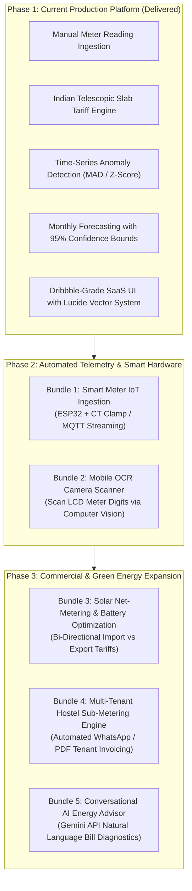

# PowerSaver: Future Engineering Roadmap & Production Bundles

> **Architectural Vision for Scale, IoT Hardware Integration, and Commercial Expansion**  
> *Prepared by Senior Full-Stack Engineering Lead (Team 7)*

---

## 🗺️ Roadmap Architecture Overview



---

## 📦 Future Feature Bundles Detail

### Bundle 1: Smart Meter & IoT Hardware Telemetry (ESP32 / MQTT)
* **Goal:** Eliminate manual entry completely for tech-enabled hostels and modern households.
* **Architecture:**
  * **Hardware Layer:** ESP32 microcontroller with non-invasive split-core Current Transformer (CT) sensors (SCT-013) clamped around the main phase line.
  * **Ingestion Pipeline:** Publishes $kWh$ pulses every 60 seconds over MQTT to an EMQX broker.
  * **Backend Integration:** FastAPI WebSocket endpoint (`/ws/telemetry`) streaming live power wattage spikes directly to the frontend chart without page refresh.

---

### Bundle 2: Computer Vision / OCR Meter Display Scanner
* **Goal:** Eliminate human transcription errors when entering 6-digit cumulative readings.
* **Architecture:**
  * Mobile Progressive Web App (PWA) camera integration.
  * Lightweight on-device OCR model (Tesseract.js or OpenCV) fine-tuned on 7-segment digital LCD meter displays.
  * Auto-extracts the cumulative $kWh$ integer, date timestamp, and verifies against previous reading ($Reading_t \ge Reading_{t-1}$).

---

### Bundle 3: Solar Net-Metering & Bi-Directional Tariff Engine
* **Goal:** Address the rapidly growing Indian rooftop solar market (PM Surya Ghar Muft Bijli Yojana).
* **Architecture:**
  * Dual-channel readings:
    $$\text{Net Billed Units} = \text{Grid Import } (kWh) - \text{Solar Export } (kWh)$$
  * Banking cycle calculations: carry-forward excess solar generation credits to future monsoon/winter billing cycles.
  * Real-time Solar Payback ROI tracker showing cumulative savings against capital investment.

---

### Bundle 4: Multi-Tenant Hostel & PG Sub-Metering Invoicing Engine
* **Goal:** Direct monetization and SaaS utility for hostel wardens, PG owners, and commercial landlords.
* **Architecture:**
  * Support parent meters (main grid) and child submeters (individual student rooms).
  * Common area power distribution algorithm (lift, corridor lighting, water pumps split proportionally by tenant room count).
  * One-click generation of branded PDF electricity bills and automated WhatsApp payment links.

---

### Bundle 5: Generative AI Energy Advisor (Gemini API Integration)
* **Goal:** Transform raw energy charts into actionable human insights.
* **Architecture:**
  * Ingest monthly consumption delta, tariff slab breakdown, and detected anomalies.
  * Feed structured prompt to Gemini API:
    ```json
    {
      "monthly_units": 380,
      "tariff_slab": "Slab 3 (₹7.50/unit)",
      "spikes": ["Nov 12: +14.5 kWh (AC surge)"],
      "appliances": ["1.5T AC (6h/day)"]
    }
    ```
  * Generates hyper-personalized natural language explanations:
    > *"Your bill this month is projected at ₹2,890 (+₹420 higher than usual). The surge occurred because your bedroom AC was operated at 19°C during the Nov 12-14 heatwave, pushing 62 units into Slab 3. Shifting your thermostat to 24°C will save ₹380/month and prevent crossing the next tariff tier."*

---

## 🚀 Deployment & Production Readiness

The project is packaged for zero-friction cloud deployment:
1. **Docker Containerization:** Fully containerized multi-stage `Dockerfile` and `docker-compose.yml`.
2. **1-Click Launcher:** `start.bat` for instant local execution.
3. **Database Migration Path:** SQLite for zero-config demos $\to$ Seamless migration to PostgreSQL / TimescaleDB via SQLAlchemy connection string configuration.
